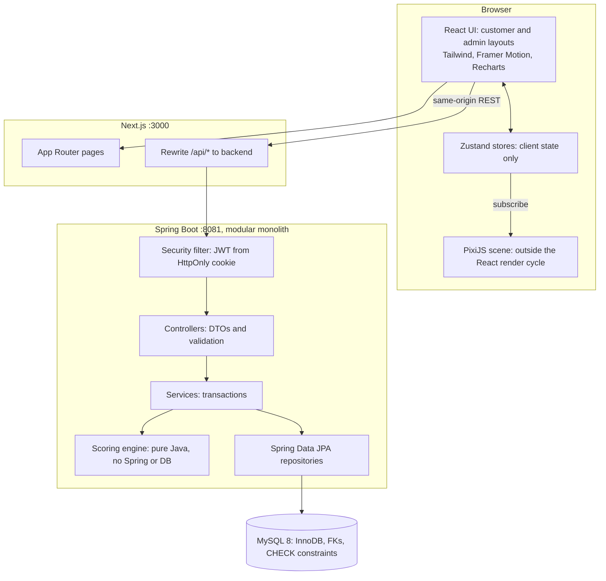
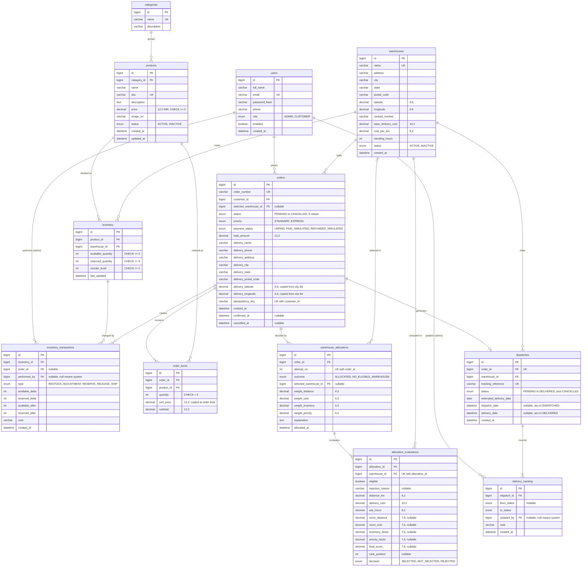
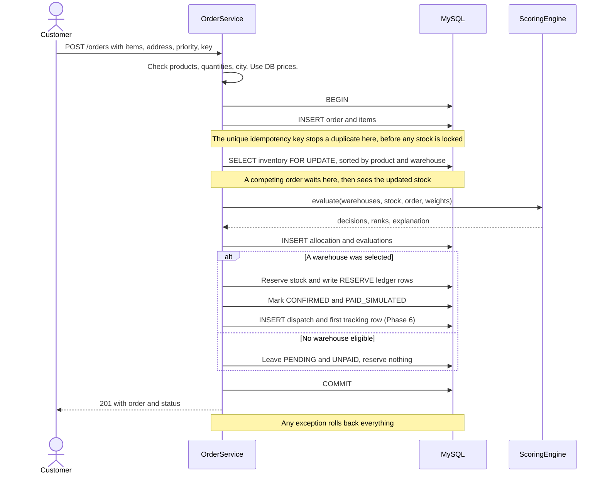
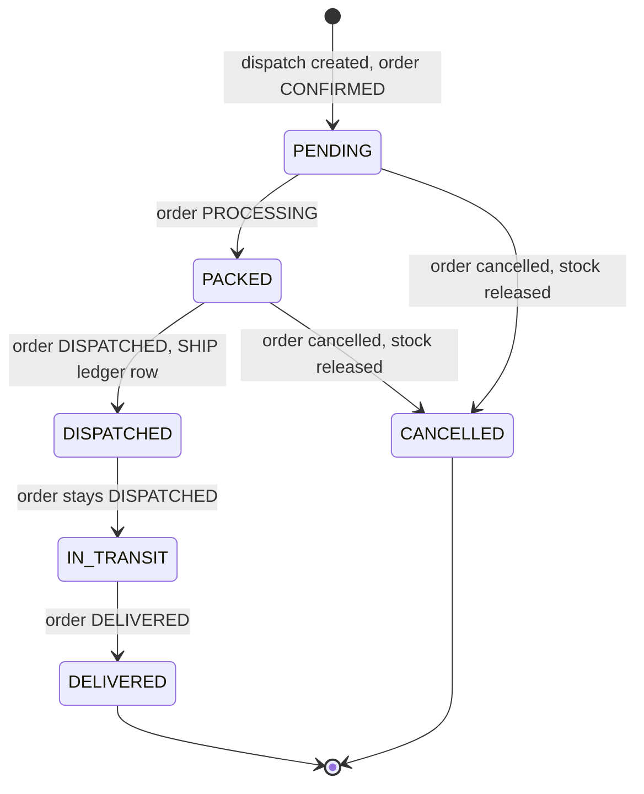
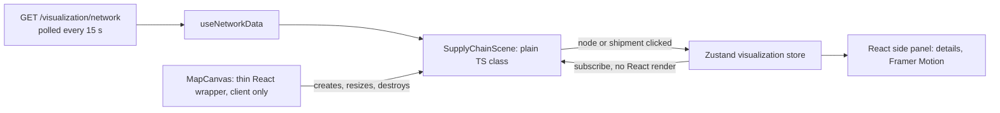

# SupplyChain OS: Phase 0 Architecture Proposal

Status: **approved 2026-11-01**, including all decisions in section 1.
Inputs: `readme.md` (engineering spec) and `Tasks.md` (execution rules).

Section 1 lists the decisions that need your approval. Everything after it is the design those decisions produce.

---

## 1. Decisions to approve

The two source documents leave these open or contradict each other. Each has a proposed default, and approving this document accepts all of them.

| # | Issue | Proposed decision | Why |
|---|---|---|---|
| D1 | **Order priority** is a scoring factor, but no order field or screen captures it. If it were the same for every warehouse, it could never affect the choice. | Add a `Standard / Express` choice at checkout, with no price difference. The factor is `urgency × normalized delivery time`, so Express favours the fastest warehouse. | Makes the factor real and easy to demonstrate. |
| D2 | **Customer location:** distance needs coordinates, checkout collects only an address, and external APIs are out of scope. | Checkout offers a fixed list of about 15 Karnataka cities, stored in a backend resource file. Coordinates are copied onto the order. Other locations are not deliverable. | Deterministic and works offline. City-level accuracy is enough for this demo. |
| D3 | **No warehouse can fulfil the order.** The spec allows rejecting or flagging it, and there is no `Rejected` status. | Save the order as `PENDING`, unpaid, with no reservation or dispatch, and store the decision showing why each warehouse failed. An admin can **re-run allocation** after restocking, or cancel. | Otherwise the *Pending Orders* KPI would always be 0, because allocation is synchronous. |
| D4 | **Split shipments:** the combined stock of several warehouses might cover an order that no single one can. | No splitting. One order ships from one warehouse, as the spec says: "cannot fulfil the entire order must never be selected". | Matches the spec and the one-order-one-dispatch model. |
| D5 | **Vitest vs. duplicated logic:** the spec wants the decision engine tested in Vitest, but it must run in the Java backend and rule 4 forbids duplicating business logic. | The engine exists only in Java and is tested with JUnit. Vitest covers frontend logic: cart, validators, map projection, timeline building. The API returns `allowedNextStatuses`, so the frontend holds no transition rules. | One source of truth. A TypeScript copy could drift from what actually runs. |
| D6 | **Settings** appears in the sidebar and weights must be configurable, but there is no such route and the table list is fixed. | Add one extra route, `/admin/settings`, showing the weights read-only. They are set in `application.yml` and copied onto each allocation record. | Stays within the required tables. Old decisions remain explainable after a weight change. |
| D7 | **Cancelled dispatches:** the shipment lifecycle has no terminal state for a cancelled order. | Add a sixth status, `CANCELLED`, reachable only by cancelling the order before it is dispatched. | Keeps the record without pretending it shipped. |
| D8 | **Project title says "AI-Powered"**, but the spec bans implying AI/ML in this MVP. | The UI uses "SupplyChain OS" and "automated decision engine". The full title appears only as the academic project name. | Rules 15 and 21 require this honesty, and a professor may well ask. |
| D9 | **Libraries the stack table doesn't list.** | Add Recharts (required by spec §17), Flyway for schema migrations, springdoc-openapi for Swagger, JJWT, and openapi-typescript (dev only). | Plain libraries, with no new services or infrastructure. |
| D10 | **Spec conflicts:** 11 vs. 12 tables, 7 vs. 8 KPIs, two different sample stock tables. | Use the larger set: 12 tables and 8 KPIs. Seed Smartphone and Headphones stock from the §12 table so the required scenario works exactly as written. | No requirement is lost. |

The spec's API list also needs these additions, covered in section 6: categories, stock movement history, logout, city list, map data, and re-run allocation.

---

## 2. This machine

| Tool | Found | Consequence |
|---|---|---|
| Java | Runtime 21, **but `javac` is 25** | Build with `--release 21` so the output runs on Java 21. |
| Maven | **Not installed** | Commit the Maven Wrapper (`mvnw`), so nothing needs installing. |
| Node / npm | 22.19 / 10.9 | Fine. |
| MySQL | 8.0.46, running on 3306; **root login denied** | **You need to create the database user once** (commands supplied in Phase 2). |
| Port 8080 | **Already used by another app** (returns HTTP 200) | The backend defaults to **8081**. I won't touch that app. |
| Docker | Installed | Not used; the spec excludes it. |

Target versions, using the latest stable releases: Next.js 16, React 19, Tailwind 4, Zustand 5, framer-motion 14, PixiJS 8, Recharts 3, Vitest 5, Spring Boot 4.1.2 (not the 4.2 release candidate).

---

## 3. System architecture



### Main decisions and trade-offs

| Decision | Alternative rejected | Trade-off accepted |
|---|---|---|
| **JWT in an HttpOnly, SameSite=Lax cookie**, same-origin through a Next rewrite | JWT in `localStorage`: any XSS could steal the token | Postman and Swagger authenticate through the cookie rather than a pasted token. |
| **Lock inventory first, then decide** (section 7) | Optimistic locking with retries: more code, and retries can still fail under load | Orders for the same products run one at a time, which is fine at demo scale. |
| **Polling**: tracking every 10 s, map every 15 s, paused in hidden tabs | WebSockets: extra moving parts for little benefit | Updates can lag by a few seconds. |
| **Flyway SQL migrations**, with Hibernate set to `validate` | `ddl-auto=update`: can't be relied on for CHECK constraints or exact indexes | The schema is written by hand. |
| **Scoring engine as a pure class** | Logic inside a service with repositories | Requires a small input/output mapping layer, but tests need no database. |
| **Generated TS types from OpenAPI** | Hand-written types that drift from the backend | One extra step whenever the API changes. |

---

## 4. Database design

### 4.1 ER diagram



### 4.2 Constraints and indexes

| Table | Constraint or index | Purpose |
|---|---|---|
| `inventory` | `UNIQUE (product_id, warehouse_id)` | One stock row per pair; also the locking path. |
| `inventory` | `CHECK` on both quantities | The **database** refuses negative stock, even if the code has a bug. |
| `inventory` | index `(warehouse_id)` | Per-warehouse views. |
| `inventory_transactions` | index `(inventory_id, created_at)`, `(order_id)` | Movement history. The application never updates or deletes these rows. |
| `orders` | `UNIQUE (customer_id, idempotency_key)` | A double-clicked checkout can't create two orders. |
| `orders` | index `(customer_id, created_at)`, `(status, created_at)`, `(selected_warehouse_id)` | Order lists and analytics. |
| `order_items` | FK to `products` is `RESTRICT` | Products on old orders can only be deactivated. |
| `warehouse_allocations` | `UNIQUE (order_id, attempt_no)` | Keeps each re-run in the history; the highest attempt is current. |
| `dispatches` | `UNIQUE (order_id)` | At most one dispatch per order. |
| `dispatches` | index `(status, created_at)`, `(warehouse_id)` | Dispatch board. |
| `delivery_tracking` | index `(dispatch_id, created_at)` | Timeline. |

All timestamps are stored in UTC and displayed in IST. Money uses `DECIMAL` and `BigDecimal`, never floating point.

### 4.3 What the stock columns mean

**Physical stock = available + reserved.** Only `available` can be sold.

| Event | available | reserved | Ledger type |
|---|---|---|---|
| Admin adds stock | + n | | `RESTOCK` |
| Admin corrects stock | ± n (never below 0) | | `ADJUSTMENT` |
| Order allocated | − q | + q | `RESERVE` |
| Order cancelled before shipping | + q | − q | `RELEASE` |
| Shipment reaches `DISPATCHED` | | − q | `SHIP` |

"Reserved cannot exceed physical stock" therefore always holds. A low-stock item means `available < reorder_level`.

---

## 5. Warehouse allocation algorithm

The algorithm has two stages: a rule-based **eligibility gate**, then **weighted scoring** among the warehouses that pass. It is deterministic and uses no randomness or LLM.

### 5.1 Stage 1: eligibility (hard rule)

A warehouse is rejected if it is inactive, or if `available < requested` for **any** line. The stored reason is specific, for example: `Insufficient stock: Smartphone (needs 10, has 5)`. Scoring can never override this stage.

### 5.2 Stage 2: scoring

**A lower score is better.** All factors run from 0 (best) to 1 (worst).

| Factor | Default weight | Raw value | Normalized value |
|---|---|---|---|
| Distance | **0.40** | Haversine km × 1.25 road factor | `km / max km among eligible` |
| Delivery cost | **0.30** | `base_delivery_cost + cost_per_km × km` | `cost / max cost among eligible` |
| Inventory suitability | **0.20** | Average of `requested / available` across lines: how much of its stock the order would use | Already 0 to 1 |
| Priority | **0.10** | `etaHours = handling_hours + km / 45` | Standard: `0`. Express: `etaHours / max etaHours` |

`Score = 0.40·Distance + 0.30·Cost + 0.20·Inventory + 0.10·Priority`, rounded to 6 decimal places.

- **Weights:** they live in `application.yml`, must sum to 1 (checked at startup), and are copied onto each allocation.
- **Normalization:** dividing by the maximum was chosen over min-max scaling. With two eligible warehouses, min-max always gives exactly 0 and 1, so 100 km vs. 101 km would look as extreme as 10 km vs. 400 km. If every value is 0, the normalized value is 0.
- **Ties, in order:** shorter distance, then lower cost, then lowest warehouse ID.
- **Single eligible warehouse:** it is still scored and recorded, then selected.
- **No eligible warehouse:** see D3.

### 5.3 Worked example (actually computed)

10 smartphones and 5 headphones to **Davanagere**, Standard priority, using proposed demo cost values (Hubli ₹120 + ₹14/km, Bengaluru ₹180 + ₹16/km, Mysuru ₹100 + ₹13/km):

| Warehouse | Eligibility | Distance | Cost | Norm. distance | Norm. cost | Inventory | Score | Decision |
|---|---|---|---:|---:|---:|---:|---:|---|
| Hubli | Eligible | 164.7 km | ₹2,426.41 | 0.5371 | 0.4770 | 0.5833 | **0.4746** | **Selected** |
| Bengaluru | Eligible | 306.7 km | ₹5,087.29 | 1.0000 | 1.0000 | 0.1833 | 0.7367 | Not selected |
| Mysuru | Short by 5 smartphones | | | | | | | Rejected |

Hubli wins on distance and cost even though Bengaluru has much more spare stock. The factors really do trade off against each other. A Tumakuru customer flips the result to Bengaluru (0.2064 vs. 0.8167).

### 5.4 Explanation text

Explanations are built only from computed facts, so they can't overclaim. They mention "lowest cost" only if that is true:

> Hubli Warehouse was selected: it had sufficient inventory and the lowest weighted score (0.4746, next best 0.7367), with the shortest distance (164.7 km) and lowest delivery cost (₹2,426.41) among eligible warehouses. Mysuru Warehouse was rejected: insufficient stock of Smartphone (needs 10, has 5).

---

## 6. API specification

All paths are under `/api`. Lists accept `page`, `size`, `sort`. Errors use RFC 9457 `ProblemDetail` plus `fieldErrors`. Swagger is served at `/swagger-ui.html`. Items marked ➕ are additions to the spec's list.

Access: **Public**, **Auth** (any logged-in user), **Cust**, **Admin**.

| Method and path | Access | Notes |
|---|---|---|
| `POST /auth/register` | Public | Always creates a CUSTOMER. |
| `POST /auth/login` | Public | Sets the cookie; returns the user and role. |
| ➕ `POST /auth/logout` | Auth | Clears the cookie, which JavaScript can't do. |
| `GET /auth/me` | Auth | |
| ➕ `GET /categories` | Public | |
| ➕ `POST`, `PUT /categories/{id}` | Admin | `POST` goes to `/categories`. |
| `GET /products`, `/products/{id}` | Public | `q`, `categoryId`. Customers see `IN_STOCK / LOW / OUT`, never per-warehouse counts. |
| `POST /products`, `PUT /products/{id}` | Admin | Validates SKU uniqueness. |
| `DELETE /products/{id}` | Admin | **Deactivates** the product. |
| `GET`, `POST /warehouses`, `GET`, `PUT /warehouses/{id}` | Admin | The detail view includes performance figures. |
| `DELETE /warehouses/{id}` | Admin | **Deactivates** the warehouse; existing reservations are unaffected. |
| `GET`, `POST /inventory`, `PUT /inventory/{id}` | Admin | `PUT` takes a change and a reason. |
| `GET /inventory/low-stock`, `/inventory/warehouse/{warehouseId}` | Admin | |
| ➕ `GET /inventory/transactions` | Admin | Stock movement history. |
| ➕ `GET /locations/cities` | Public | Deliverable cities (D2). |
| `POST /orders` | Cust | Runs section 7. The server sets prices. Sends `Idempotency-Key`. |
| `GET /orders` | Admin | `status`, `q`, `warehouseId`. |
| `GET /orders/my-orders` | Cust | |
| `GET /orders/{id}` | Owner or Admin | **404** for other customers' orders, so IDs can't be probed. |
| `PATCH /orders/{id}/cancel` | Owner or Admin | Only before `DISPATCHED`. |
| ➕ `POST /orders/{id}/reallocate` | Admin | `PENDING` orders only (D3). |
| `GET /allocations`, `/allocations/{orderId}`, `/allocations/{orderId}/evaluations` | Admin | Latest attempt by default. |
| `GET /dispatches`, `/dispatches/{id}` | Admin | `status`, `q`. Includes `allowedNextStatuses`. |
| `PATCH /dispatches/{id}/status` | Admin | **409** on an invalid transition. |
| `GET /tracking/order/{orderId}` | Owner or Admin | Timeline. Admins get extra fields. |
| `GET /tracking/dispatch/{dispatchId}` | Admin | |
| `GET /analytics/dashboard`, `/orders`, `/warehouses`, `/inventory`, `/dispatches` | Admin | Live SQL aggregates; date-range filters. |
| ➕ `GET /visualization/network` | Admin | Warehouses, routes and shipment states for the map. |
| ➕ `GET /settings/allocation` | Admin | Active weights (D6). |

---

## 7. Order lifecycle and transaction safety

### 7.1 Order placement (one transaction)

The spec's step order is select → lock → re-verify. This design locks **before** selecting, which is stricter and meets the same goal. The decision is made on data that can't change underneath it, so re-verification can't fail and no retry logic is needed.



**The spec's race (stock 10, two orders of 7):** the second order waits for the lock, then sees 3 available. That warehouse is rejected, so the order is re-evaluated against the others right away. If none qualify, it stays `PENDING`. The stock can't be oversold, and the `CHECK` constraint is a second safeguard.

**Deadlocks:** every flow locks in one fixed order: the order row first, then inventory rows sorted by product and warehouse. A lock timeout returns a retryable **503**, and the idempotency key makes that retry safe.

### 7.2 Status mapping

Shipment status is the driver, and order status follows it in the same transaction:



Transitions move forward one step only. Each one writes a `delivery_tracking` row. Cancelling also sets the payment status to `REFUNDED_SIMULATED` if it was paid.

The customer timeline uses real records throughout: `orders.created_at` (Placed), `orders.confirmed_at` (Confirmed), `warehouse_allocations.allocated_at` (Allocated), and `delivery_tracking` for the rest. Placed, Confirmed and Allocated share almost the same timestamp, because they really do happen together.

Estimated delivery date = allocation date + `ceil(etaHours / 24)` days, plus 1 extra day for Standard.

---

## 8. Backend structure

```text
backend/
  mvnw, pom.xml
  src/main/java/com/supplychain/
    config/       OpenAPI, Clock, typed properties (weights, JWT)
    security/     JWT service, cookie filter, SecurityFilterChain
    auth/  user/  category/  product/  warehouse/
    inventory/    InventoryService (only writer of stock and ledger)
    order/        OrderService (the section 7 transaction)
    allocation/
      engine/     WarehouseScoringEngine: pure Java, no Spring or JPA
      location/   City list, distance calculation
    dispatch/     DispatchService, ShipmentStatus transition rules
    tracking/  analytics/  visualization/
    seed/         Dev-profile data seeder
    common/       Paging, base types
    exception/    Global handler producing ProblemDetail
  src/main/resources/
    application.yml, application-dev.yml, application-test.yml
    db/migration/V1__schema.sql
    data/karnataka-cities.json
  src/test/java/...
```

Each feature package holds its own `Controller`, `Service`, `Repository`, entity and `dto/`. Controllers contain no business logic.

**Secrets:** the database password, `JWT_SECRET` and seed passwords come from environment variables, with no defaults in source. `.env.example` lists the names. Demo credentials appear only in the README.

---

## 9. Frontend structure

```text
frontend/src/
  app/
    (customer)/        Shopping layout
      page.tsx, products/, products/[id]/, cart/, checkout/,
      orders/, orders/[id]/, profile/
    admin/             Dashboard layout, protected
      page.tsx, products/, products/new/, warehouses/, inventory/,
      orders/, orders/[id]/, dispatch/, analytics/, settings/
    login/, register/
  proxy.ts             Redirects if the auth cookie is absent (convenience only)
  components/
    ui/                Button, Input, Select, Badge, DataTable, Drawer, Modal,
                       Toast, Skeleton, EmptyState, ErrorState, Pagination, StatCard
    layout/  products/  inventory/  warehouses/  orders/
    dispatch/  analytics/  visualization/
  stores/              auth/ cart/ ui/ filters/ warehouse/ orders/
  services/            api/ (one client) auth/ products/ inventory/
                       warehouses/ orders/ dispatch/ analytics/
  hooks/  types/  utils/  lib/
  types/api.generated.ts
```

Notes:

- **No extra pages:** editing products, warehouse details and dispatch details open in **drawers** on their list pages, because the spec limits routes.
- **Real authorization is on the server:** the route guard and layouts only improve the experience; the backend enforces every rule.
- **Zustand holds client state only:** user summary, cart (product ID and quantity, persisted), sidebar, filters, map selection. Prices and stock are always fetched. The token never reaches JavaScript.
- **Login:** one `/login` page redirects by role. Admins go to `/admin`, customers to `/`. Public registration can't create admins.
- **Top bar:** notifications come from real low-stock and pending-order counts; search goes to the relevant filtered list.
- **Product images:** local SVG files, so the demo works offline.

### Design system

Light neutral background, deep navy sidebar, white surfaces with 1 px borders, one blue accent, small corner radius (4 to 6 px), and an 8 px spacing grid. Tables are compact with right-aligned tabular numbers. Status colours are reserved: green delivered, blue in progress, amber low stock or pending, red rejected or cancelled. They are always paired with a text label so they don't rely on colour alone.

---

## 10. PixiJS visualization

**Placement:** on `/admin` (network overview), `/admin/orders/[id]` (allocation replay) and `/admin/dispatch` (shipments). There is no separate route.



**Layers, bottom to top:** Karnataka outline (simplified polygon, labelled "schematic"), warehouse links, routes, customer points, warehouse nodes, shipment markers, labels.

**Projection:** a linear mapping of latitude and longitude onto the canvas. It is a pure function, so Vitest can test it.

| Backend state | What the map shows |
|---|---|
| Warehouse selected | Highlighted node. The side panel shows location, inventory, products, active orders and dispatches. |
| Allocation replay | Stored evaluations play in steps: all warehouses highlight, rejected ones turn red with the reason, eligible ones turn blue, the winner gets emphasis, then the route draws to the customer with the order number. |
| `PENDING` / `PACKED` | Marker at the warehouse. |
| `DISPATCHED` | Marker leaves along the route. |
| `IN_TRANSIT` | Marker moves along the middle of the route, and can be clicked to inspect. |
| `DELIVERED` | Marker at the customer; the route fades. |

Replays use **stored decisions**; nothing is recalculated in the browser. Marker movement is labelled **"Simulated position, not GPS"**, and marker position comes from status alone.

**Lifecycle:**
- Next.js keeps visited pages mounted but hidden (React `Activity`), running effect cleanup when they hide and effects again when they return. All scene setup and teardown must therefore live in effects, so a hidden map holds no running ticker or WebGL context.
- PixiJS 8 starts asynchronously, and React StrictMode mounts components twice in development. The wrapper guards against this so a cancelled mount can't leave a canvas behind.
- Unmounting stops the ticker, removes the store subscriptions and resize observer, and calls `destroy({ children: true })`.
- Under `prefers-reduced-motion`, the scene jumps straight to final states.
- If WebGL is unavailable, PixiJS's Canvas renderer is used if it starts. Otherwise a message appears, and the rest of the page keeps working.

---

## 11. User journeys

**Customer:** browse or search → product detail → cart (guests allowed) → log in → checkout with city, Standard/Express and simulated payment → confirmation with warehouse and estimated date → `/orders/[id]` timeline, refreshing automatically.

**Administrator:** log in → control tower with KPIs, map and alerts → inventory → incoming order → allocation comparison and replay → dispatch board, advancing through Packed, Dispatched, In Transit, Delivered → analytics.

**Failure path (D3):** an order nobody can fulfil → customer sees "awaiting stock", unpaid → admin sees it flagged with each warehouse's reason → admin restocks → re-runs allocation → normal flow continues.

---

## 12. Seed data

The seeder runs only under the `dev` profile, only on an empty database.

**History goes through the real services**, with an adjustable clock for past dates. Allocations, ledger rows and tracking in the 15+ historical orders are therefore genuine output, and the analytics are true to the data. A final set of recorded `ADJUSTMENT` rows then brings stock to the demo values, so the required scenario starts exactly as specified.

- 3 warehouses, 5 categories, 12 products, 1 admin, 10 customers, every shipment status, several low-stock rows.
- **Required scenario:** 10 smartphones + 5 headphones, using the §12 stock table.
- **No-stock scenario:** "Monitor" with 4 units in each warehouse. Ordering 6 fails everywhere, though 12 exist in total, which demonstrates D4 clearly.

---

## 13. Testing plan

| Layer | Tool | Coverage |
|---|---|---|
| Engine | JUnit, no Spring | Eligibility, insufficient stock, normalization, zero-division, weighted score, ranking, every tie-break level, single and no eligible warehouse, the section 5.3 example as a fixed test |
| Security | MockMvc + MySQL | Login, bad credentials, role denial, access to another customer's order |
| Services | Spring Boot + **real MySQL** (`supplychain_test`) | Order creation, allocation storage, dispatch creation, transitions, cancel and release, re-run, idempotency, rollback when a step is forced to fail |
| **Concurrency** | Real threads + real MySQL | 10 in stock, two orders of 7: never oversold. With another warehouse available, the second order moves there. A larger run of 20 parallel orders, checking that stock totals match the ledger. |
| Frontend | Vitest | Cart maths, validators, INR formatting, timeline building, map projection |

H2 is deliberately not used: row locking and CHECK behaviour differ from MySQL, so the concurrency tests would prove little. Testcontainers needs Docker, which the spec excludes.

---

## 14. Roadmap

Each phase ends with a report of the work, files and test results, a checklist update, and **a stop for your approval**.

| Phase | Deliverable | Done when |
|---|---|---|
| 0 | This document | You approve it. |
| 1 | Frontend foundation, design system, shared components, layouts | Lint, type check, build and Vitest pass. |
| 2 | Spring Boot, MySQL, schema, entities, JWT and roles | Auth tests pass on real MySQL. |
| 3 | Products, categories, warehouses, inventory (API and UI) | Ledger tests pass; admin screens work against the real API. |
| 4 | Catalogue, cart, checkout, order placement | A customer can place an order through the UI. |
| 5 | Scoring engine, allocation, reservation | **Engine and concurrency tests pass.** The spec requires tests before moving on, and this is the highest priority. |
| 6 | Dispatch, transitions, tracking timeline | Customer sees admin updates live. |
| 7 | PixiJS map and replay | All map elements come from real data; no leaks on repeated navigation. |
| 8 | Control tower and analytics | Figures match direct SQL checks. |
| 9 | Full integration, seed polish, final README | The 20-step demo in `Tasks.md` runs end to end from a clean database. |

Progress is tracked in [`CHECKLIST.md`](CHECKLIST.md).

---

## 15. Risks

| Risk | Impact | Mitigation |
|---|---|---|
| Spring Boot 4 is recent, so springdoc or JJWT compatibility may lag | Medium | Verify in Phase 2. Fall back to Boot 3.5 (if still supported) only with your approval. |
| `java` 21 and `javac` 25 mismatch | Low | `--release 21`; note it in the README. |
| Pixi 8 async startup under StrictMode | Medium | Guarded lifecycle (section 10); test repeated navigation. |
| Polling appears slow during the live demo | Low | Tracking refreshes on window focus too. |
| Demo laptop differs from this machine | Medium | Documented setup; seeded data; no external services needed at runtime. |
| City-level locations are coarse | Low, accepted | Stated openly as a limitation. |
| Single-warehouse rule causes `PENDING` orders even when total stock is enough | Low, accepted | The reason is displayed, and it is a good discussion point. |
| Scope is large for a phased build | Medium | Phases 2 to 6 come first; visual polish never takes priority over reservation correctness. |
